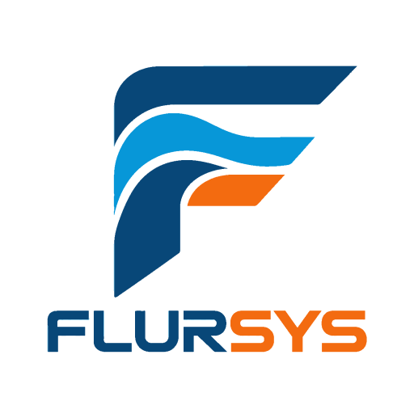
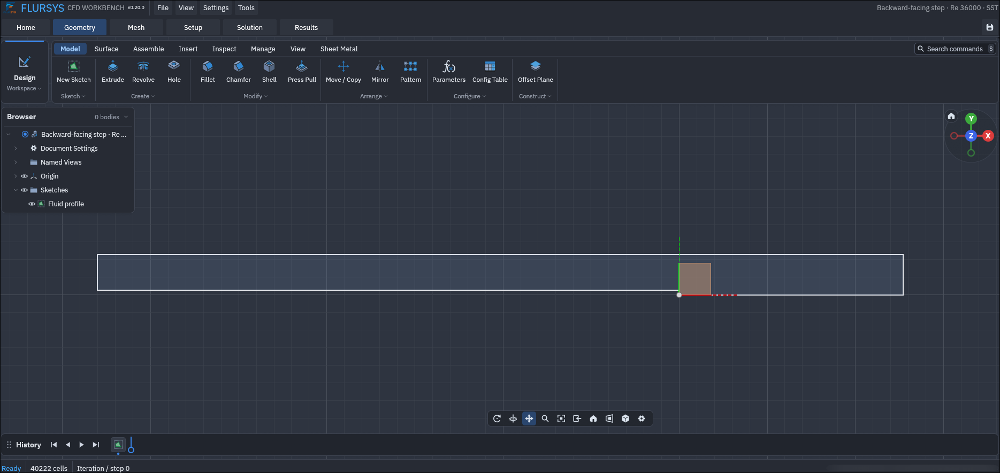
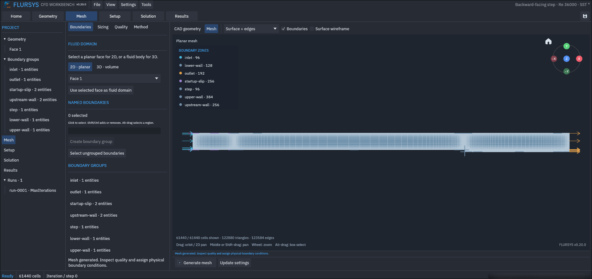
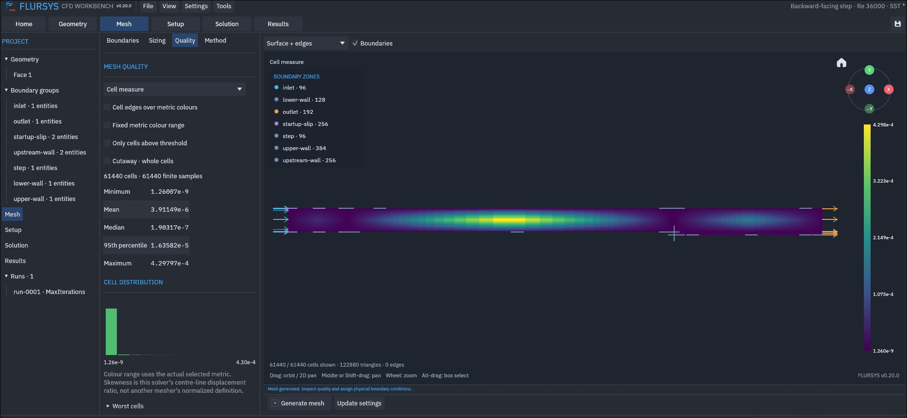
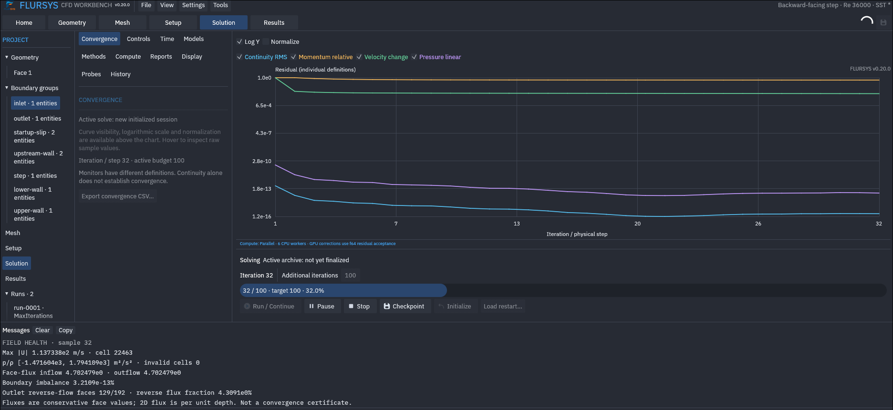
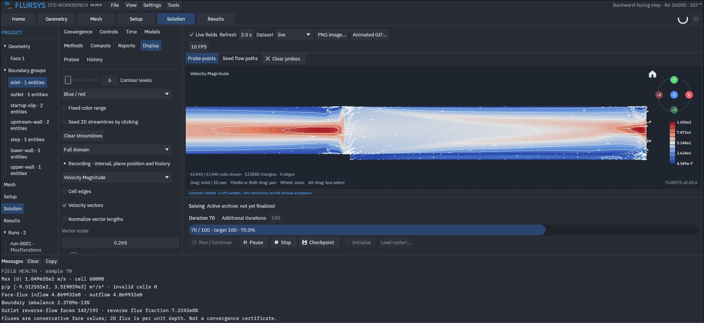

<p align="center">
  
</p>

<h1 align="center">FLURSYS</h1>

<p align="center">
  <strong>A CFD workbench built in Rust.</strong><br>
  Create geometry, generate a mesh, solve fluid flow and explore the results.<br>
  Use the desktop interface, automate runs with the CLI and Rust API, or connect AI agents through MCP.
</p>

<p align="center">
  <a href="https://github.com/A1i98/FLURSYS/releases/latest"></a>
  <a href="https://github.com/A1i98/FLURSYS/releases/latest"></a>
  <a href="https://github.com/A1i98/FLURSYS/releases/latest"></a>
</p>

<p align="center">
  <a href="docs/README.md">Documentation</a> ·
  <a href="examples/README.md">Examples</a> ·
  <a href="https://github.com/A1i98/FLURSYS/issues">Issues</a> ·
  <a href="CONTRIBUTING.md">Contributing</a>
</p>

<p align="center">
  <a href="https://github.com/A1i98/FLURSYS/actions/workflows/ci.yml"></a>
  <a href="https://github.com/A1i98/FLURSYS/releases"></a>
  <a href="https://github.com/A1i98/FLURSYS/releases"></a>
  <a href="#license"></a>
</p>

---

FLURSYS combines SolidCraft CAD, Gmsh meshing and finite-volume solvers in one workspace. It includes steady and transient flow, turbulence models, heat transfer, buoyancy, compressible flow, boundary scripts and result playback.

## Screenshots

| Geometry | Mesh |
| --- | --- |
|  |  |
| **Mesh quality** | **Convergence** |
|  |  |
| **Live flow display** | |
|  | |

## Results

Explore the [example results](examples/validation/).

## Build and run

Install Rust and Gmsh. On Linux, install the Fontconfig development package as well.

```sh
git clone --recurse-submodules https://github.com/A1i98/FLURSYS.git
cd FLURSYS
cargo run --release --bin flursys-gui
```

Windows packages include Gmsh. For other installations, put `gmsh` on PATH or select its executable in Settings.

## Run an example

Open **File → Examples**, or use the CLI:

```sh
cargo build -p flursys --release --no-default-features --bin flursys
./target/release/flursys examples create laminar-channel ./channel
./target/release/flursys project mesh ./channel
./target/release/flursys project solve ./channel
```

Cases are editable JSON files in [examples/cases](examples/cases). The library includes Couette flow, natural convection, cylinder flow, Taylor–Green vortex, sudden expansion and Sod shock tube.

## Documentation

[Workbench](docs/WORKBENCH.md) · [Meshing](docs/MESHING.md) · [CLI](docs/CLI.md) · [MCP](docs/MCP.md) · [Numerical methods](docs/NUMERICAL_METHODS.md) · [Development](docs/DEVELOPMENT.md)

## License

FLURSYS is available under [MIT](LICENSE) or [Apache 2.0](LICENSE-APACHE). Third-party components retain their own licenses; see [THIRD_PARTY_NOTICES.txt](THIRD_PARTY_NOTICES.txt).
