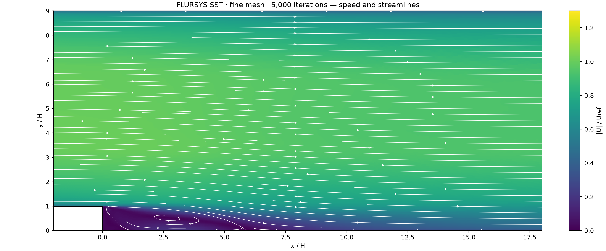
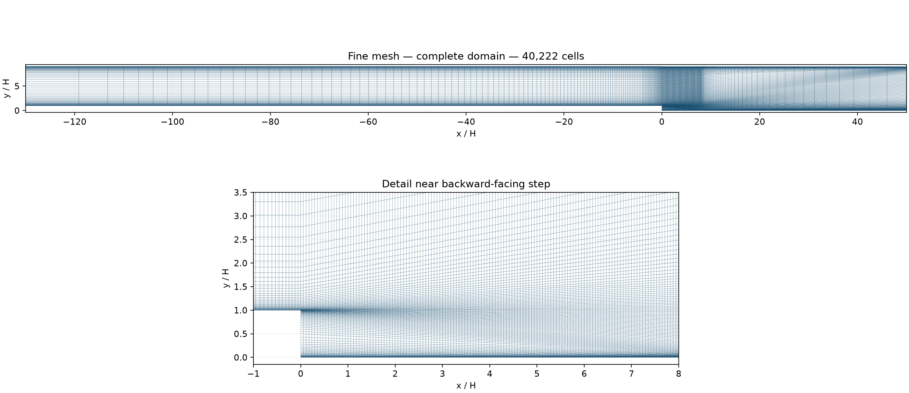
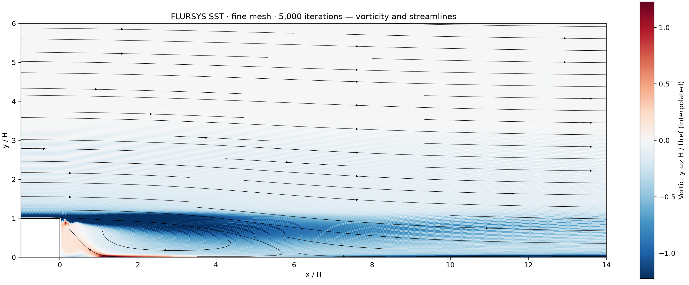
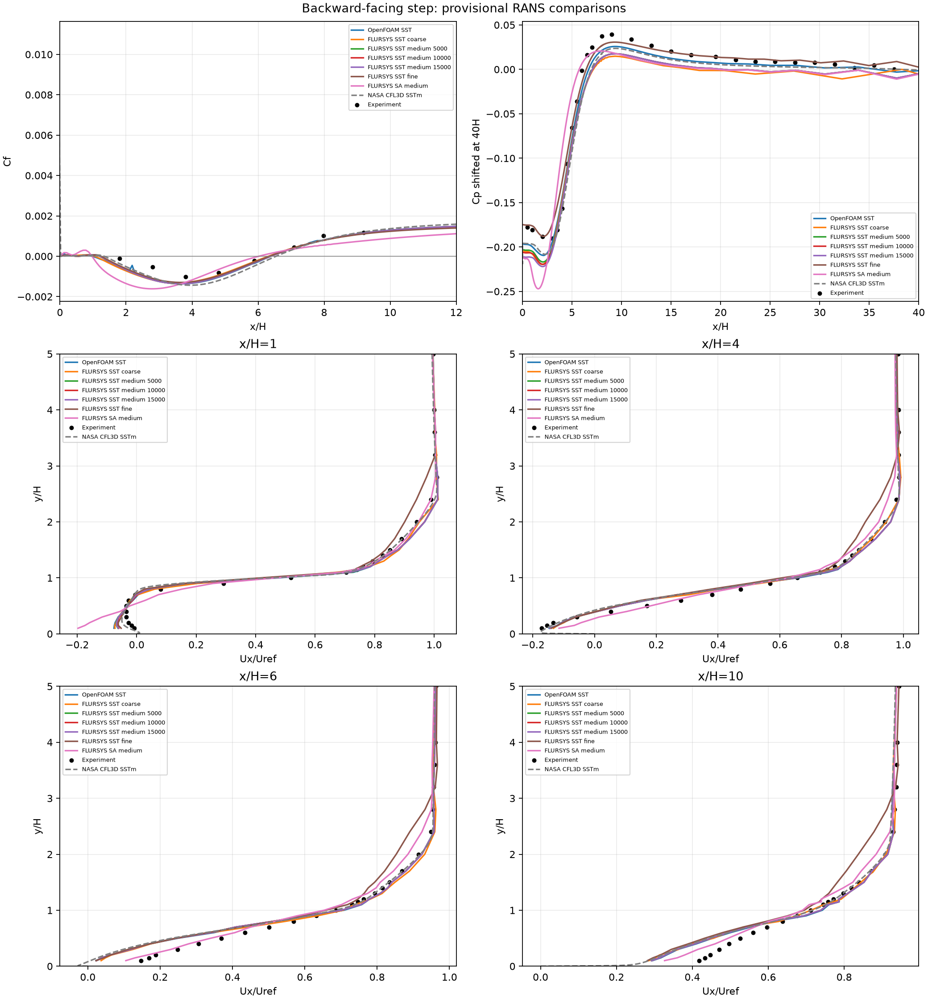

# Backward-facing step

A two-dimensional RANS study at Re = 36,000, compared with the [Driver–Seegmiller experiment](https://tmbwg.github.io/turbmodels/backstep_val.html) and NASA SSTm results.

| Velocity and streamlines | Mesh | Vorticity |
| --- | --- | --- |
|  |  |  |

**Reference comparison**

| SST mesh | Cells | Iterations | Reattachment x/H |
| --- | ---: | ---: | ---: |
| Coarse | 8,610 | 5,000 | 6.313 |
| Medium | 20,540 | 15,000 | 6.376 |
| Fine | 40,222 | 5,000 | 6.341 |
| Experiment | — | — | 6.26 ± 0.10 |

[Comparison data](comparison.json) · [Velocity profiles](velocity-profiles.csv) · [Wall coefficients](wall-coefficients.csv) · [Run settings](run-metadata.json) · [Example case](../../cases/backward-facing-step-re36000)
