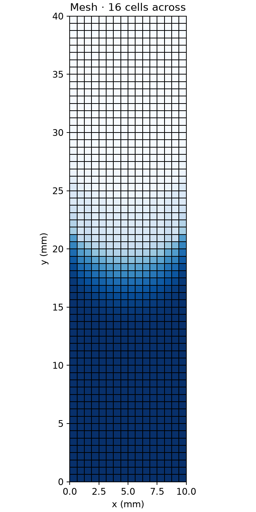
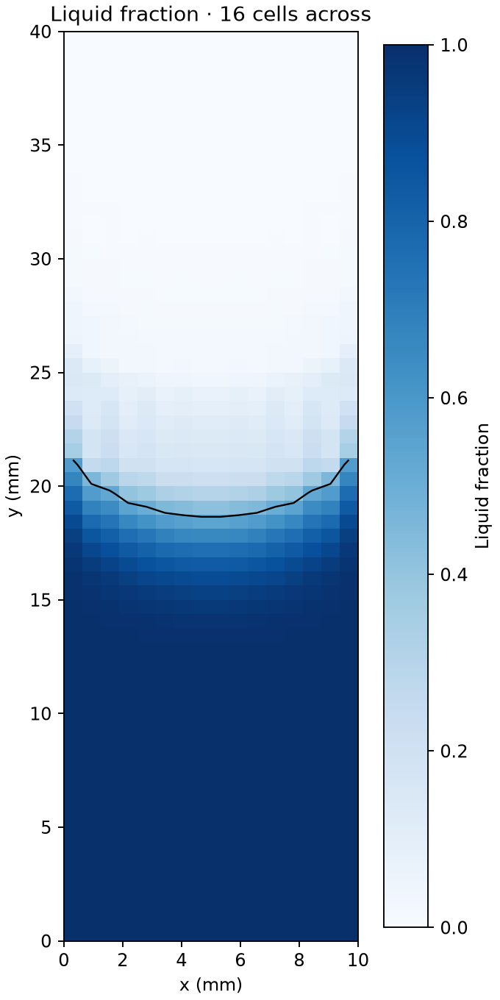

# Capillary rise between parallel plates

The liquid rises between plates 10 mm apart. The Ω = 1 case follows [Gründing et al.](https://doi.org/10.1016/j.apm.2020.04.020), with a 30° contact angle and a corrected equilibrium apex height of 19.154 mm.

| Mesh | Time | Apex at 0.2 s | Reference at 0.2 s | Difference |
| ---: | ---: | ---: | ---: | ---: |
| 8 cells across | 1.999 s | 18.402 mm | 20.883 mm | 11.88% |
| 16 cells across | 2.005 s | 17.408 mm | 19.934 mm | 12.67% |

The reference values are the article's interFoam numerical-slip results. FLURSYS uses no-slip walls and upwind phase transport, so the transient results are not a like-for-like comparison.

| Mesh | Liquid fraction |
| --- | --- |
|  |  |

Both runs end near 18.65 mm, about 2.62% below the corrected equilibrium height. Nonzero velocities remain, and the difference between meshes at 0.2 s means mesh independence has not been established. Detailed measurements are in [metrics.json](metrics.json).

The [example case](../../cases/capillary-rise) uses a planar initial interface and an unstructured mesh. It is a separate setup and does not reproduce these results.

The numerical reference data are from [Smuda et al.](https://doi.org/10.25534/tudatalib-173). The repository metadata and attached license file state different licenses; clarify the license before redistributing the reference data or derived comparison.
