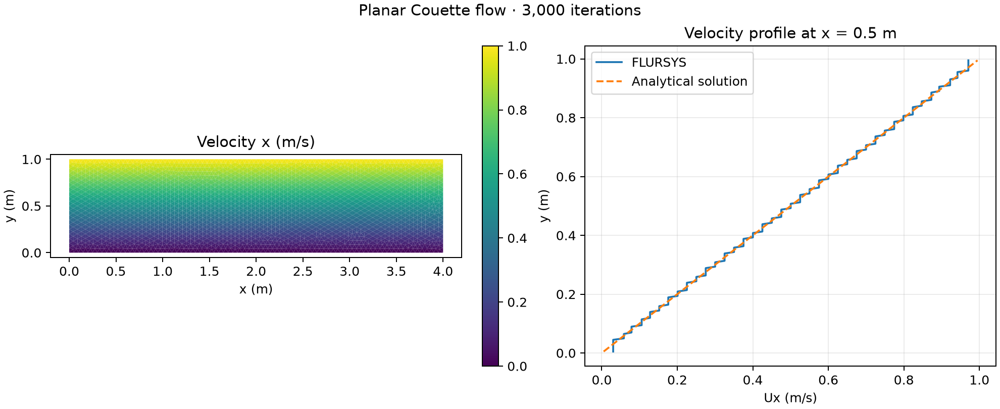

# Planar Couette flow

Laminar flow between parallel plates with height 1 m and upper-wall speed 1 m/s. The analytical solution is Ux = y m/s.

The 3,746-cell run reached 3,000 iterations. The mean absolute error over cell centres is 0.000361 m/s. The run reached its iteration limit; the solver's full stopping criteria were not met.

[Profile data](profile.csv) · [Metrics](metrics.json) · [Run settings](run-settings.json) · [Example case](../../cases/couette-planar)
