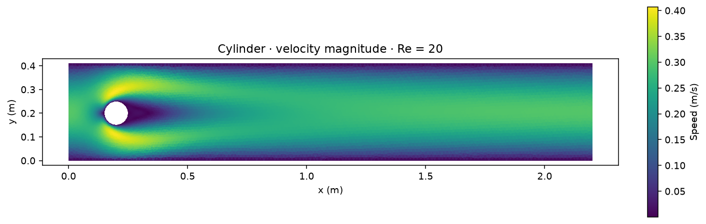
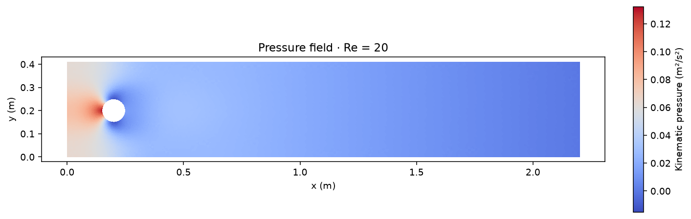
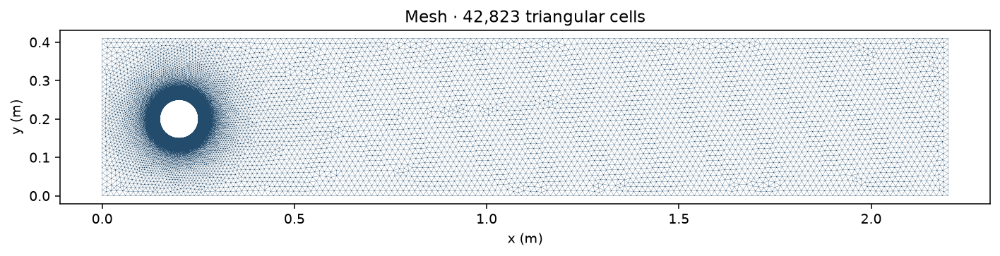
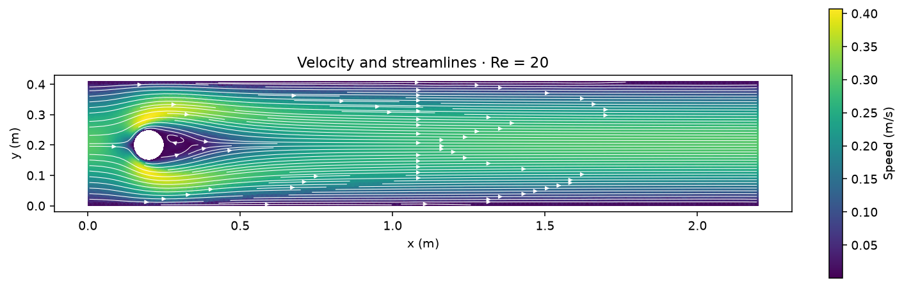
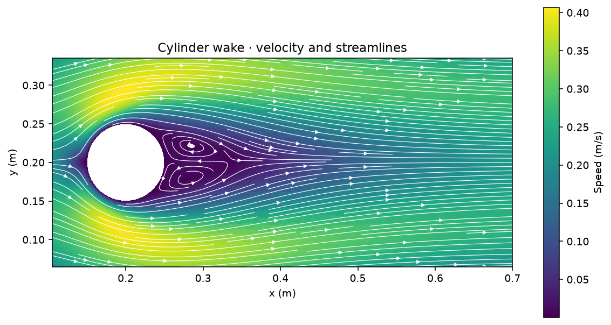
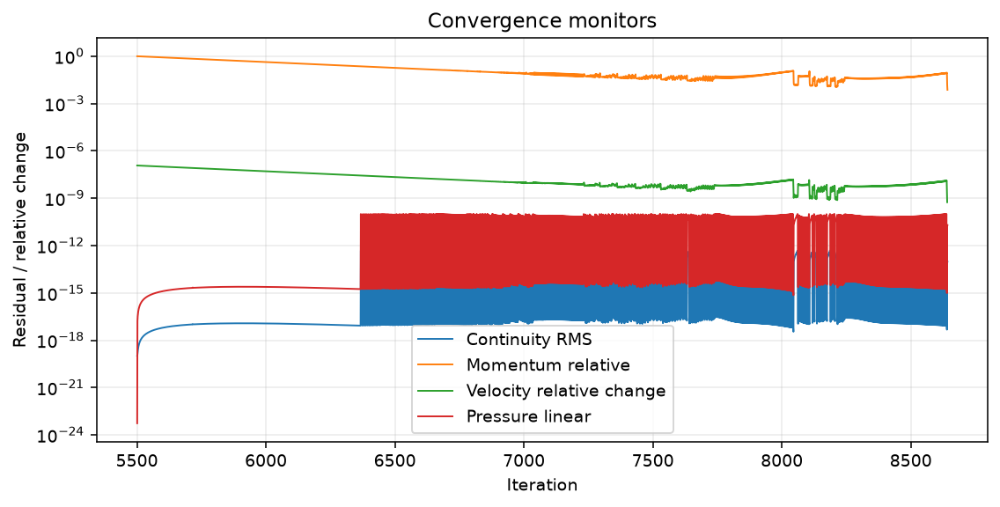

# Cylinder in a channel · DFG 2D-1 · Re = 20

Steady laminar flow around a cylinder of diameter 0.1 m in a 2.2 m × 0.41 m channel. The cylinder centre is at (0.2, 0.2) m; density is 1 kg/m³, kinematic viscosity is 0.001 m²/s, and the parabolic inlet has a mean speed of 0.2 m/s.

The fine run stopped with `converged` at iteration 8,642 using the solver’s absolute momentum-residual alternative.

| Velocity contour | Pressure contour | Mesh |
| --- | --- | --- |
|  |  |  |

| Flow in channel | Cylinder wake |
| --- | --- |
|  |  |

**Difference from reference**

| Quantity | DFG reference | 15,894 cells, converged | 42,823 cells, converged* |
| --- | ---: | ---: | ---: |
| Drag coefficient | 5.579535 | 5.554965 | 5.573287 |
| Lift coefficient | 0.010619 | 0.012371 | 0.013585 |
| Pressure difference, approximate | 0.117520 | 0.116240 | 0.116912 |
| Iterations | — | 1,507 | 8,642 |

Reference: [FEATFLOW DFG benchmark 2D-1](https://wwwold.mathematik.tu-dortmund.de/~featflow/en/benchmarks/cfdbenchmarking/flow/dfg_benchmark1_re20.html), based on Schäfer and Turek (1996) and the high-order reference results listed there.

[Comparison data](comparison.csv) · [Metrics and pressure sample locations](metrics.json) · [Fine run settings](run-settings.json) · [Source example](../../cases/dfg-cylinder-2d-2)
