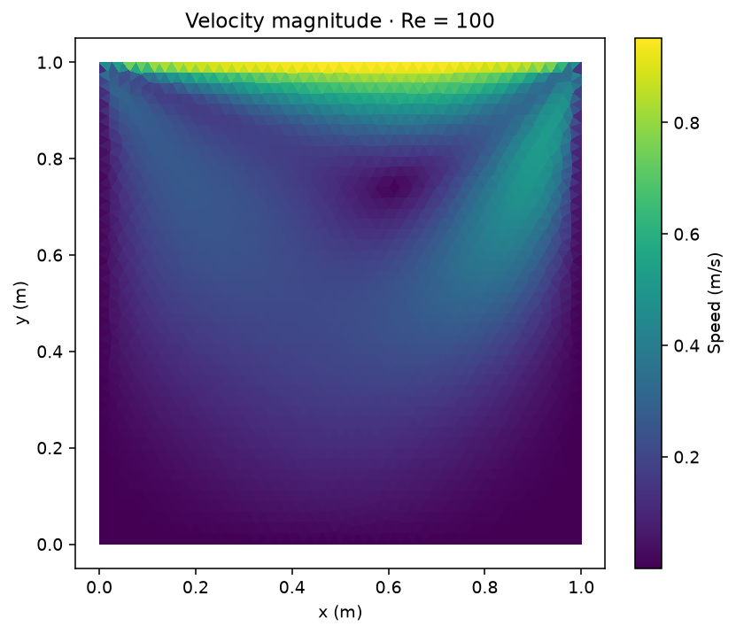
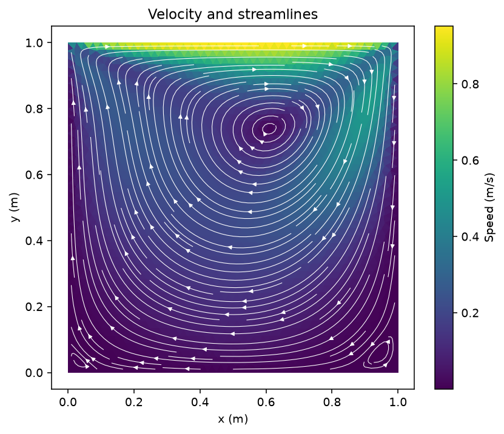
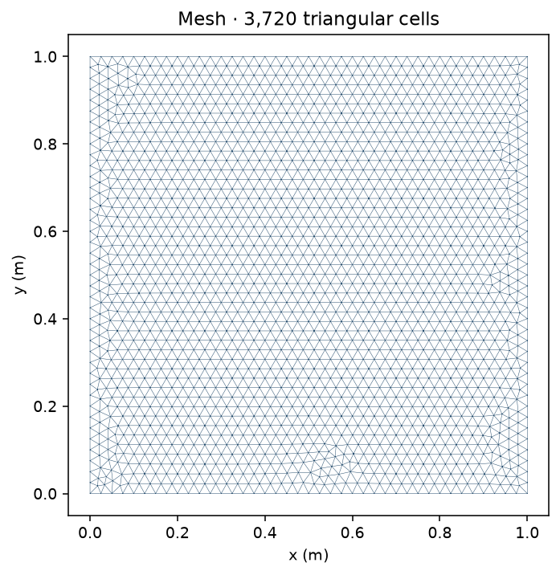
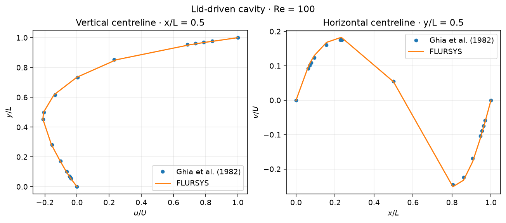
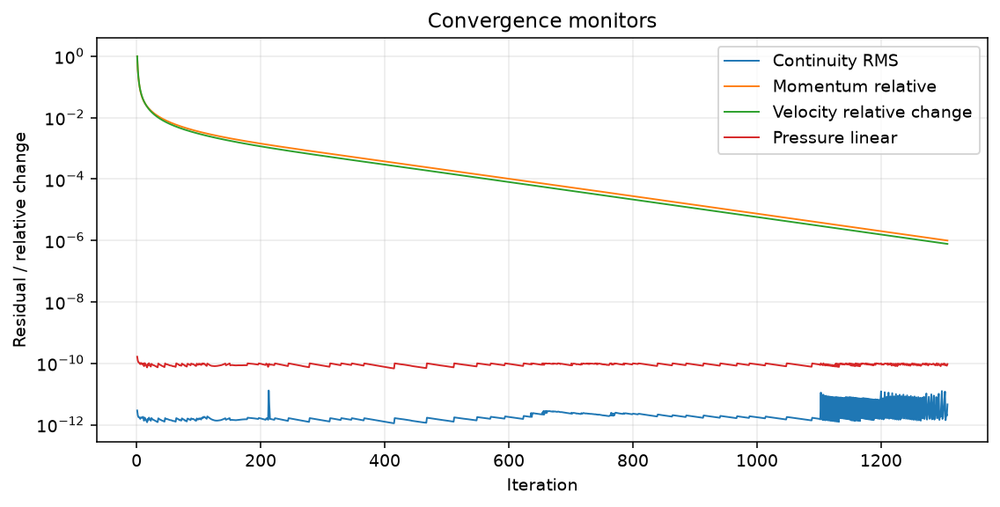

# Lid-driven cavity · Re = 100

Steady laminar flow in a 1 m square cavity with the top wall moving at 1 m/s. Density is 1 kg/m³ and kinematic viscosity is 0.01 m²/s. The other three walls are stationary.

| Velocity contour | Velocity and streamlines | Mesh |
| --- | --- | --- |
|  |  |  |

**Centreline comparison**

| FLURSYS 0.21.1 | Result |
| --- | ---: |
| Triangular cells | 3,720 |
| Iterations | 1,307 (converged) |
| Continuity RMS | 4.60 × 10⁻¹² |
| Momentum relative residual | 9.97 × 10⁻⁷ |
| Relative velocity change | 7.74 × 10⁻⁷ |

| Centreline velocity | Interior points | MAE / U | RMSE / U | Maximum error / U |
| --- | ---: | ---: | ---: | ---: |
| u at x/L = 0.5 | 15 | 0.00572 | 0.00762 | 0.01807 |
| v at y/L = 0.5 | 15 | 0.00640 | 0.00665 | 0.00933 |

Reference: [Ghia, Ghia and Shin (1982), *High-Re solutions for incompressible flow using the Navier–Stokes equations and a multigrid method*](https://doi.org/10.1016/0021-9991%2882%2990058-4), Tables I and II. The numerical reference values were transcribed from the published tables; the [u](https://gist.github.com/ivan-pi/3e9326d18a366ffe6a8e5bfda6353219) and [v](https://gist.github.com/ivan-pi/caa6c6737d36a9140fbcf2ea59c78b3c) transcriptions are also available online.

[Centreline u data](centerline-u.csv) · [Centreline v data](centerline-v.csv) · [Ghia u](ghia-re100-u.csv) · [Ghia v](ghia-re100-v.csv) · [Metrics](metrics.json) · [Run settings](run-settings.json) · [Example case](../../cases/lid-driven-cavity)
