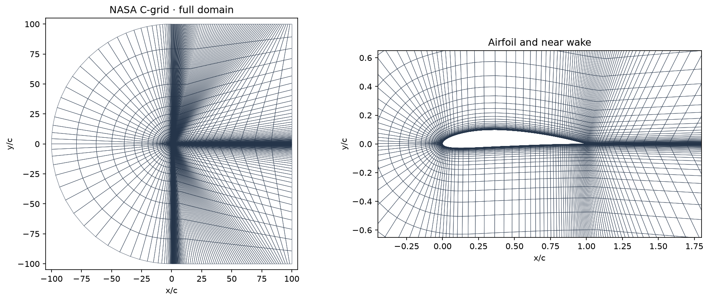
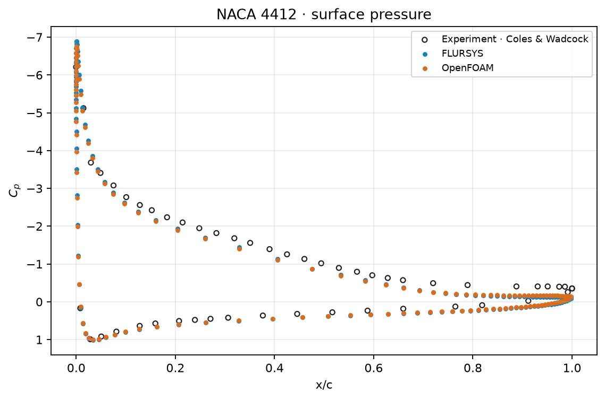
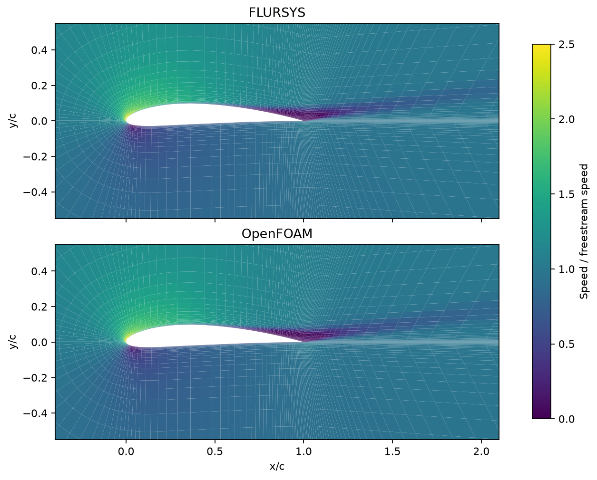

# NACA 4412

Steady k–ω SST flow at Re = 1.52 million and α = 13.87°, using NASA's 14,336-cell C-grid.

| Quantity | FLURSYS | OpenFOAM |
| --- | ---: | ---: |
| Lift coefficient | 1.6026 | 1.5781 |
| Drag coefficient | 0.03391 | 0.03083 |
| Surface Cp RMSE, upper | 0.216 | 0.225 |
| Surface Cp RMSE, lower | 0.123 | 0.116 |

Cp errors compare interpolated surface values with the experimental pressure taps. The solvers use the same mesh and wall ω values, but differ in numerical methods and SST implementation.

| Mesh | Pressure comparison |
| --- | --- |
|  |  |

Sources: [NASA case](https://tmbwg.github.io/turbmodels/naca4412sep_val.html) · [Coles and Wadcock](https://doi.org/10.2514/3.61127)
