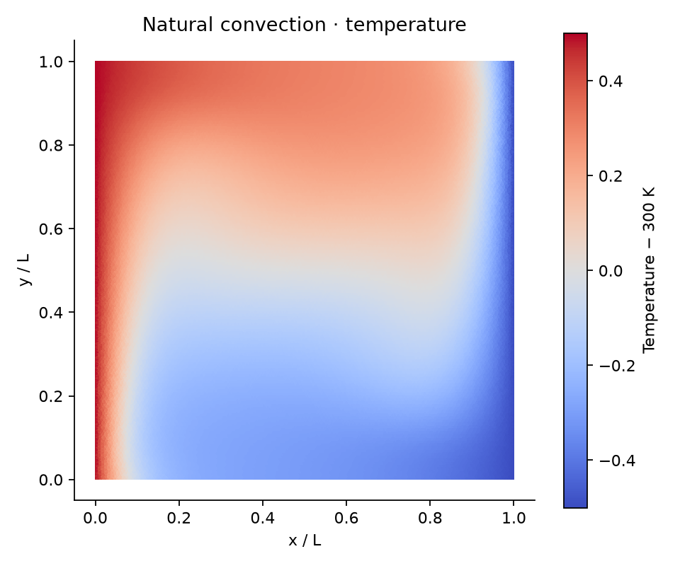
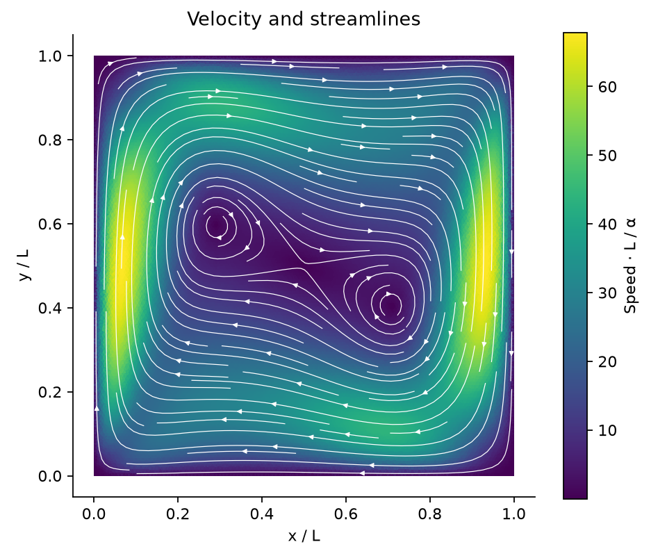
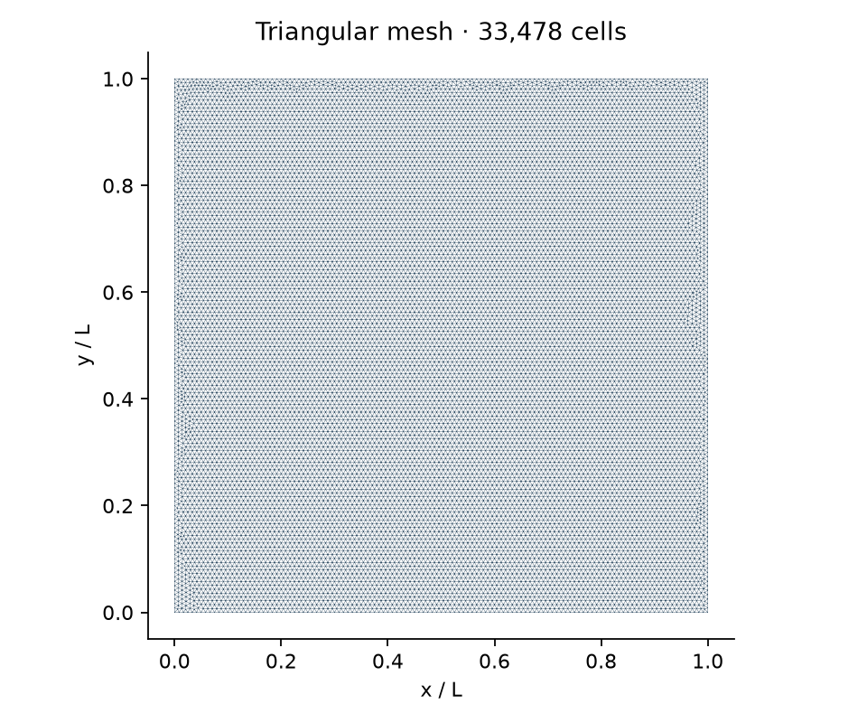
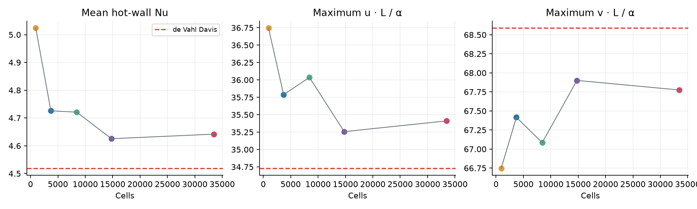

# Natural convection · Ra = 10⁵

Steady Boussinesq flow in a square cavity, with a hot left wall, a cold right wall and insulated horizontal walls. The reference is the numerical benchmark by [de Vahl Davis (1983)](https://doi.org/10.1002/fld.1650030305); it is not an experimental measurement.

| Temperature | Velocity and streamlines | Mesh |
| --- | --- | --- |
|  |  |  |

| Quantity | Reference | 33,478 cells | Difference |
| --- | ---: | ---: | ---: |
| Mean hot-wall Nusselt number | 4.519 | 4.6418 | +2.72% |
| Maximum horizontal velocity, uL/α, on x/L = 0.5 | 34.73 | 35.411 | +1.96% |
| Maximum vertical velocity, vL/α, on y/L = 0.5 | 68.59 | 67.775 | −1.19% |

| Triangular cells | Hot-wall Nu | Stop status |
| ---: | ---: | --- |
| 944 | 5.0243 | Iteration limit |
| 3,714 | 4.7258 | Converged |
| 8,430 | 4.7211 | Converged |
| 14,778 | 4.6255 | Converged |
| 33,478 | 4.6418 | Converged |

Nusselt numbers use a first-cell wall-normal temperature difference, integrated along the wall; they are reconstructed values, not the algebraic solver flux. Centreline velocities use linear interpolation of cell-centred fields. The runs use `Pr = 0.71`, first-order upwind convection and reduced pressure; solver settings and individual metrics are in [metrics.json](metrics.json). The [example case](../../cases/natural-convection-ra-100000) can be opened in FLURSYS.
