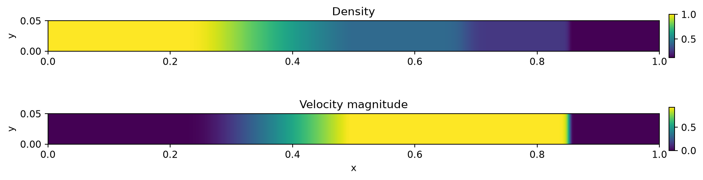
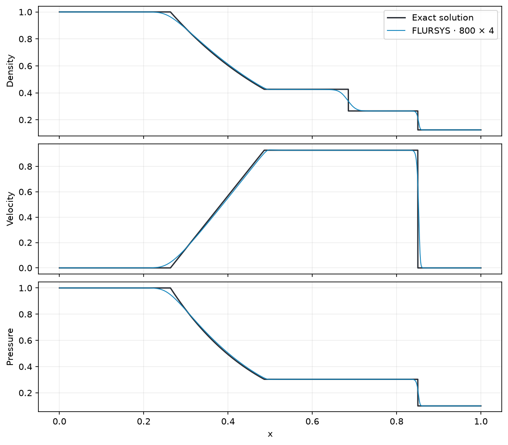
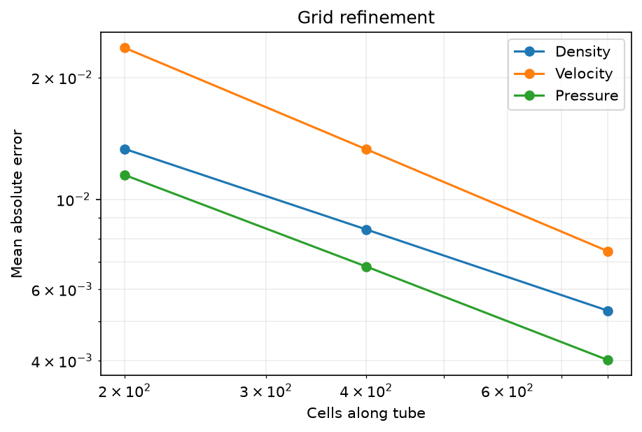
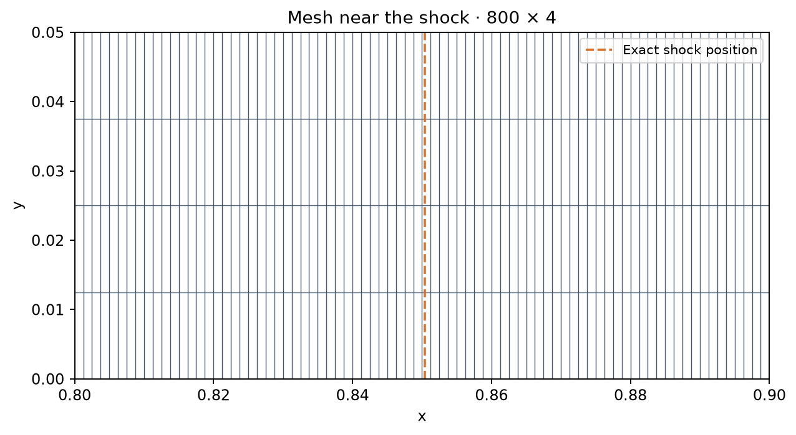

# Sod shock tube

An inviscid ideal-gas shock tube at t = 0.2, solved with HLLC and SSP-RK2. The initial left state is (ρ, u, p) = (1, 0, 1), the right state is (0.125, 0, 0.1), and γ = 1.4.

| Cells along tube | Density MAE | Velocity MAE | Pressure MAE |
| ---: | ---: | ---: | ---: |
| 200 | 0.01332 | 0.02367 | 0.01149 |
| 400 | 0.00843 | 0.01330 | 0.00683 |
| 800 | 0.00532 | 0.00745 | 0.00402 |

| Profiles | Grid refinement |
| --- | --- |
|  |  |

[Metrics](metrics.json) · [Case](../../cases/sod-shock-tube) · [Sod (1978)](https://doi.org/10.1016/0021-9991(78)90023-2)
