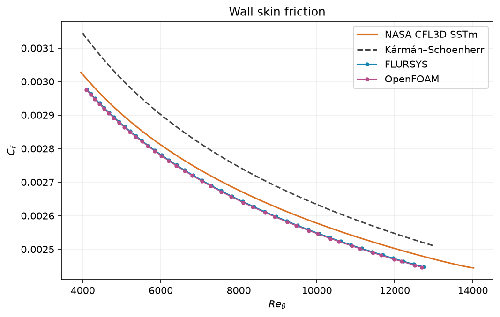
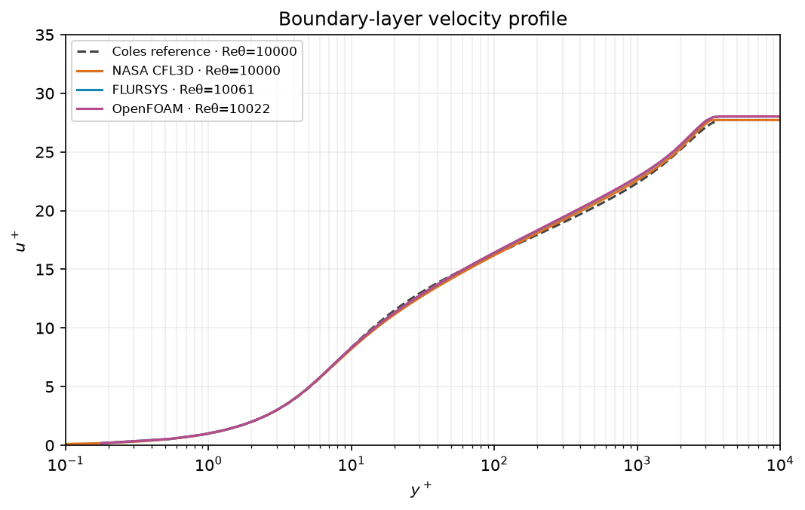
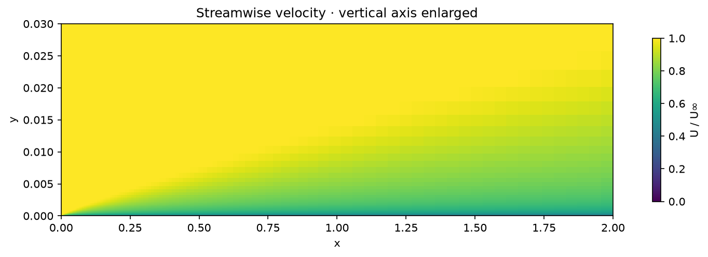

# Turbulent flat plate

Steady k–ω SST flow on NASA's flat-plate grid at Re/m = 5 million. FLURSYS and OpenFOAM use the same 137 × 97 grid and matched inlet turbulence conditions.

| Skin-friction comparison | Mean absolute relative difference |
| --- | ---: |
| FLURSYS vs. NASA CFL3D SSTm | 1.07% |
| OpenFOAM vs. NASA CFL3D SSTm | 1.17% |
| FLURSYS vs. OpenFOAM | 0.11% |
| FLURSYS vs. Kármán–Schoenherr correlation | 3.76% |
| FLURSYS between 69 × 49 and 137 × 97 grids | 1.28% |

| Skin friction | Velocity profile |
| --- | --- |
|  |  |

The bundled example opens with the reference mesh and inlet conditions. OpenFOAM uses the same mesh and wall ω values; numerical methods and SST implementations differ.

[Metrics](metrics.json) · [NASA reference](https://tmbwg.github.io/turbmodels/flatplate_val.html) · [NASA SSTm results](https://tmbwg.github.io/turbmodels/flatplate_val_sst.html)
