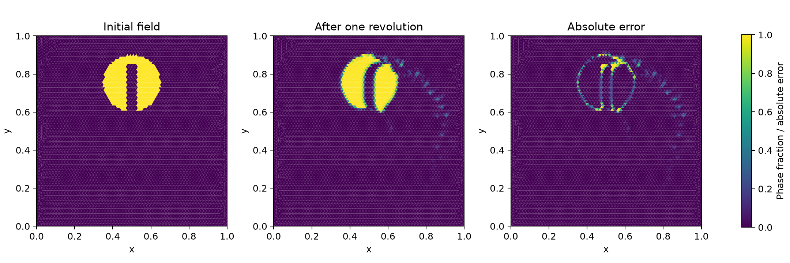

# Slotted-disk rotation

A slotted phase region rotates once in a prescribed solid-body velocity field. After one revolution, the exact phase field is the initial field. This checks phase advection, not a coupled flow solve. The setup follows the slotted-disk benchmark associated with [Zalesak (1979)](https://doi.org/10.1016/0021-9991(79)90051-2).

| Triangular cells | Steps | Compression | Normal | Relative L1 shape error | Phase area change |
| ---: | ---: | ---: | --- | ---: | ---: |
| 2,396 | 256 | 0 | — | 78.25% | −0.0202% |
| 2,396 | 256 | 0.25 | Face difference | 76.51% | −0.0161% |
| 9,518 | 512 | 0 | — | 42.39% | −0.00033% |
| 9,518 | 512 | 0.25 | Face difference | 27.73% | −0.00019% |
| 9,518 | 512 | 0.5 | Reconstructed gradient | 20.53% | −0.00040% |
| 9,518 | 512 | 1 | Reconstructed gradient | 22.64% | −0.00001% |

All runs use flux-corrected transport, one physical revolution and binary cell-centre initialization. The optional compression adds a limited conservative anti-diffusive flux; it can distort interfaces, and its coefficient requires a sensitivity study. The figure shows the reconstructed-gradient run with coefficient 0.5. Relative L1 error is the area integral of the absolute field difference divided by the initial phase area. Phase fractions remained in [0, 1]. After accounting for phase leaving the open boundaries, the global area balance error was below 8 × 10⁻¹⁶ in the listed runs.

The finer mesh and moderate compression reduce shape error, but significant deformation remains. These results are a numerical verification against the exact final field, not evidence that the method meets a specified accuracy threshold. See [metrics.json](metrics.json) and the [example case](../../cases/zalesak-disk).
